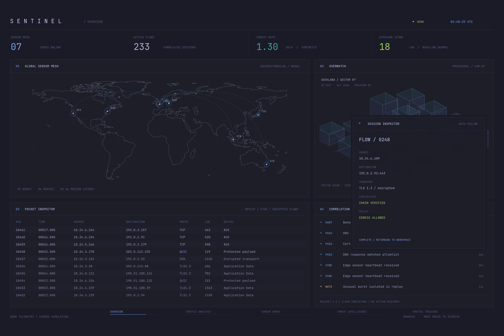

# Sentinel

A theme-aware, high-DPI security observation screensaver for Omarchy. Compact type, fine vector coastlines, slow workspace transitions, and native GTK/Cairo rendering. Uses your current Omarchy colors. The default mode reads real data.



## Live workspaces

- **Traffic:** established TCP/UDP socket endpoints from `ss`, interface throughput and packet counters, system load, memory use, and observed connection changes. Read-only, sampled every two seconds. No packet payloads, decryption, scans, geolocation guesses, or invented security verdicts.
- **Overview / city observation:** a rotating orthographic globe, aerial imagery inset, city markers and a real embedded video window. The bundled collection has 74 public camera sources in 12 cities. Direct HLS video, recent traffic clips, periodically refreshed camera images, and two public webcam embeds rotate automatically, with each visible feed held for 45 seconds. Players preload invisibly, run muted for three seconds before reveal, and keep the previous camera visible while the next starts. Failed players are skipped and backed off for ten minutes. Each view is labeled as live video, a recent clip, or a refreshed snapshot. Video availability varies; unreachable players are skipped. Original provider branding remains during playback. No webcam device is opened. See [camera sources](CAMERAS.md).
- **Threat intelligence:** CISA's Known Exploited Vulnerabilities catalog, with publication and cache dates. Catalog entries are global intelligence, not evidence that your machine is affected.
- **Orbital tracking:** real CelesTrak OMM elements for a subset of space stations and Starlink satellites, propagated with SGP4. Shows estimated current positions, a selected object's ground track, NORAD ID, altitude, element epoch, and cache age. The selected object changes every 30 seconds. This is calculated orbital tracking, not direct radio telemetry. Up to 12 station-group objects and 64 Starlink objects are displayed; this is not the entire constellation.

- **Aviation:** reported ADS-B aircraft positions from ADSB.lol, queried around the selected camera city in World mode, or fixed around your selected location in local mode, every 20 seconds. World queries cover 180 nautical miles; local queries convert the configured radius to nautical miles (25–250 NM). Callsigns, altitude, heading, and speed appear on an aerial basemap. Source age stays visible; coverage varies. Data is provided under ODbL 1.0.
- **Road conditions:** London disruptions from TfL in World mode, or nearby Caltrans active and scheduled closures for supported California locations. Refreshed every five minutes, with incident locations and source times. Planned closures are labeled separately from active closures. Other locations display an explicit coverage message; no congestion speeds are inferred.

- **Natural hazards:** USGS M2.5+ earthquakes from the past seven days; NOAA NWS point alerts in US location mode, including flood and severe-weather products; NOAA NHC active Atlantic/Eastern Pacific cyclones and basin outlooks; and GDACS disaster reports. Regional mode filters earthquakes by distance and alternates regional and cyclone-basin map context. Eastern Pacific storms stay visible for west-coast locations even outside the local radius. The outlook is basin context, not a prediction of local impact. Weather includes Open-Meteo modeled current conditions and a three-day forecast. Each source carries its received/issue time, and cached fallback is marked stale.
- **Media events:** rotating publisher headlines from Google News RSS, scoped to a location or an optional news query. World mode uses world headlines. These are media reports, not official hazard alerts or a measurement of social-media popularity.

Nine workspaces crossfade through a 376-second cycle when all sources are enabled. Disabled sections are skipped. Rendering runs at 12 FPS with a 1600×1000 logical canvas, scaled to the display. Orbit estimates update every two seconds. CelesTrak and CISA feeds are cached under `~/.cache/sentinel/` and refreshed every six hours. Cached data remains usable during outages, with its age visible. HTTP errors stop automatic requests for that source; check the URL/service before removing the corresponding `.blocked` marker from the cache. Public feeds need internet access; local telemetry does not.

## Location and source settings

Open **Sentinel Settings** from your app launcher, or run:

```sh
sentinel-screensaver --settings
```

Choose **World** (the published default), **My location** (city/country or US ZIP), or **Automatic** (approximate public-IP location). City search offers matching places for you to select. Automatic mode queries ipwho.is when you request detection and at each live launch; if a lookup fails, the saved approximate location remains usable. VPNs can affect the result. World mode does not request IP geolocation.

Set the local focus radius (25–500 km), earthquake radius (50–3,000 km), weather units, optional news focus, and individual camera/flight/road/earthquake/weather/news/satellite sources. **Save** writes preferences and closes the settings window. **Save & preview** also opens a live preview with the new settings. Typing a new location and saving resolves it first; ambiguous matches require selecting a result. Settings apply on the next screensaver launch. Local flight tracking stays centered on your chosen location as cameras rotate. Orbital mode follows the nearest ground positions in the tracked subset; this does not imply overhead visibility.

Nearby California camera catalogs are fetched from up to three neighboring Caltrans districts and cached for six hours. Up to 32 nearby cameras are selected, with HLS video falling back to a refreshed image when available. Elsewhere, local cameras use supported sources from the bundled collection within your radius; coverage is not universal. Local mode does not silently substitute distant cameras.

Preferences live in `${XDG_CONFIG_HOME:-~/.config}/sentinel/settings.json` with user-only permissions. Installation preserves preferences. No personal location is included in this repository. Search sends your query to Zippopotam.us (US ZIP) or Open-Meteo/GeoNames; location-based data requests send approximate coordinates or a city query to their respective public providers. No GPS or webcam permission is requested. Weather, earthquake, news, and road responses are cached under `~/.cache/sentinel/feeds/`; map tiles and camera catalogs use their own subdirectories. These ambient screens can lag their sources; follow the linked official agencies for current instructions.

## Install

Requires Python, GTK 3, PyGObject, Pycairo, WebKitGTK 4.1, GStreamer video decoders, `ss` (iproute2), and Python venv/pip. On Omarchy these GTK dependencies may already be installed; otherwise use `omarchy pkg add python-gobject python-cairo gtk3 python-pip webkit2gtk-4.1 gst-libav gst-plugins-good`.

```sh
git clone https://github.com/samcapshaw/sentinel.git
cd sentinel
./install.sh
```

The installer copies the app into `~/.local/share/sentinel-screensaver`, creates an isolated Python environment using system GTK bindings, installs the pinned SGP4 dependency, and adds `~/.local/bin/sentinel-screensaver`. If Screensaver Manager is installed, it registers and selects Sentinel. Normal session locking remains managed by Omarchy.

```sh
sentinel-screensaver --settings       # Location and source controls
sentinel-screensaver --preview        # Live window
sentinel-screensaver                  # Live fullscreen
sentinel-screensaver --demo --preview # Offline procedural demonstration
sentinel-screensaver --snapshot preview.png # Always synthetic; safe to share
sentinel-screensaver --terminal       # Original synthetic terminal display
```

Press **S** in the screensaver to dismiss it and open settings. Other keys dismiss fullscreen use; mouse movement also dismisses after a short startup grace period. When launched by Screensaver Manager, dismissal stops its verified runner to avoid reopening. The native window uses Omarchy's screensaver identity.

Live screens show local and remote IP addresses. Those remain in memory and are not logged or included in exported snapshots. Public HTTPS requests also fetch ADSB.lol aircraft positions, TfL/Caltrans road data, USGS, NOAA NWS/NHC, GDACS, Open-Meteo, Google News RSS, and Esri World Imagery tiles. Aerial imagery is stored imagery, not live satellite photography; tiles are cached for seven days under `~/.cache/sentinel/maps/`, with attribution shown in every map. Other requests fetch CelesTrak and CISA feeds, plus public transport-camera images and video streams, YouTube public camera embeds, and their media resources. Only the active and incoming cameras load; the entire catalog is not streamed simultaneously. Video uses WebKit’s software video sink by default to avoid GPU video teardown faults seen on this machine; `WEBKIT_GST_DISABLE_GL_SINK=0` opts back into GPU video rendering. Camera playback uses an ephemeral browser context and a loopback-only HTML server. It denies device permissions and plays muted. Demo mode creates neither a browser nor a local server. No credentials or privileged capture tools are required. Demo mode disables live collectors and uses explicitly simulated traffic, cameras, and investigations.

## Development

```sh
python -m venv --system-site-packages .venv
.venv/bin/pip install -r requirements.txt
.venv/bin/python -m unittest discover -v
```

Tests run offline. See [CelesTrak's format documentation](https://celestrak.org/NORAD/documentation/gp-data-formats.php) and [CISA's KEV catalog](https://www.cisa.gov/known-exploited-vulnerabilities-catalog) for source details. Orbit precision depends on element age, maneuvers, and SGP4's model; this is an ambient display, not a navigation service.

Original code is MIT licensed. Bundled coastlines are [Natural Earth](https://www.naturalearthdata.com/about/terms-of-use/) public-domain 1:110m data, rounded to three decimal places. SGP4 is an external MIT-licensed dependency. Bundled hls.js 1.6.13 is Apache-2.0 licensed; see `vendor/hls.LICENSE` and `THIRD_PARTY.md`. Camera links do not grant rights to redistribute provider footage.
